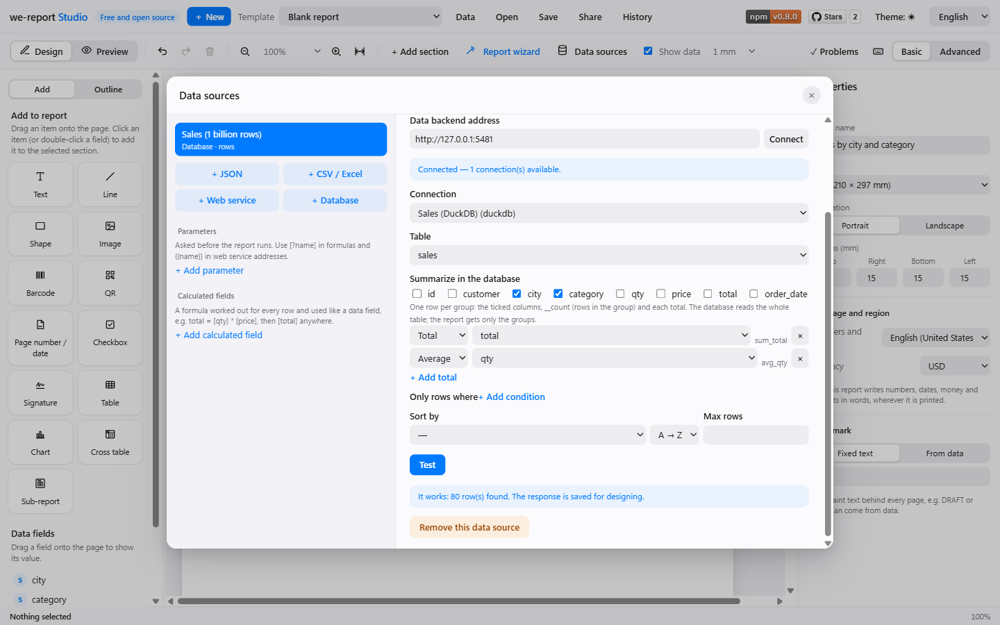
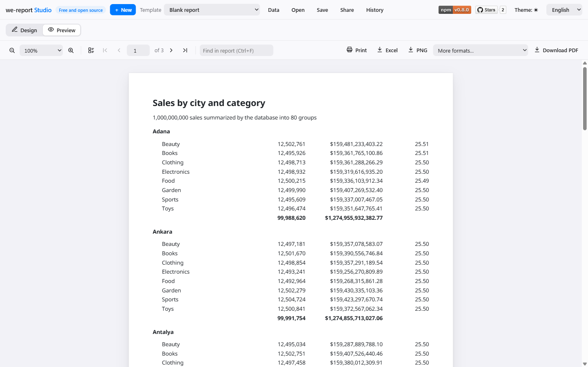

# we-report

[](https://www.npmjs.com/package/we-report-angular)
[](https://www.npmjs.com/package/we-report-angular)
[](https://www.npmjs.com/package/we-report-core)
[](https://www.npmjs.com/package/we-report-core)
[](https://github.com/emrecirik/we-report/actions/workflows/ci.yml)
[](https://github.com/emrecirik/we-report/actions/workflows/compat.yml)
[](LICENSE)
[](https://angular.dev)
[](docs/localization.md)

**Free, open-source, native Angular report designer and viewer.** Design banded reports with drag
and drop, bind them to JSON, Excel/CSV, web services or live databases, preview, print and export to
PDF, Excel and PNG — the DevExpress XtraReports / Crystal Reports experience, MIT licensed, with **no
backend required**.

**Try it:** [we-report Studio](https://emrecirik.github.io/we-report/) · **Install:** `npm install we-report-angular we-report-core`

## Why

- **The preview is the PDF.** One layout engine measures text with the embedded font, so the
  screen, the printout and the PDF break lines and pages in exactly the same places.
- **Data first.** Paste a table from Excel, call a web service or pick a database table — then
  The *Report wizard* builds a tidy report with headers, groups, sorting, totals and page numbers.
- **Live data while designing.** Fields show the first record's real values, not `[CustomerName]`.
- **Plain language.** "Grow to fit text", "Keep group on one page", "Show only when" — a Basic mode
  that hides everything a first report does not need.
- **Any backend, or none.** Everything runs in the browser. For live databases there is a small,
  documented protocol and ready-made backends for **.NET, Spring Boot, Node.js, Python, PHP and Go**.
- **Yours.** Your fonts embedded in PDFs, your colours (designer theme and report styles), English
  and Turkish out of the box, free forever.

## What is in it

| | |
|---|---|
| Paper | ISO A0–A6, B4/B5, Letter, Legal, Tabloid, Executive, envelopes, 58/80 mm receipt rolls (page grows with content), label sheets, business cards, any custom size, portrait/landscape, margins, mirrored margins, page colour |
| Sections | Report header/footer, page header/footer, nested groups (sort by key or by their total, top N, keep together, keep with first row, repeat on every page, page numbers per group), detail with zebra stripes, inner lists, side-by-side labels, page breaks, print-when formulas, report footer at the bottom of the last page, page header/footer off the first or last page; a section taller than a page continues on the next; bookmarks / document map |
| Items | Text and data fields (rich text with **bold**/*italic* and fields inside), tables, charts (incl. sparklines, data bars and gauges), cross tables (pivot), sub-reports, signature lines, lines, rectangles/ellipses, images (embedded or from an address), 1D/2D barcodes and QR codes (Code128, EAN, UPC, ITF, GS1-128, DataMatrix, PDF417, Aztec …, as vectors), checkboxes, page number / page X of Y / print date |
| Formulas | `[Price] * [Qty]`, `Iif`, `Switch`, `Sum/Count/Avg/Min/Max` per group/page/report, running and carried-forward totals, shares of the grand total (`SumAll`), calculated fields, amounts in words, text, math and date functions (`DateDiff`, `AddMonths` …), Turkish casing, `[^.invoiceNo]` parent fields, `[?param]` parameters — no `eval` |
| Formats | Numbers, money, percent, dates — with the locale (`1.234,50 ₺`, `5 Ocak 2026`) |
| Data | JSON, CSV/Excel paste (Turkish numbers and dates recognised), web services (direct or via backend, paged APIs), SQL Server, PostgreSQL, SQLite, DuckDB (via a backend) — big tables summarized in the database, report parameters with drop-down lists, pictures from web addresses |
| Designer | Drag from toolbox and field list, move/resize with grid and alignment-guide snapping, multi-select, undo/redo, in-place editing, format painter, *Tidy up*, report wizard, problems list with one-click fixes, properties panel, preview tab, light/dark |
| Output | Paged preview, print, PDF (embedded subset fonts, bookmarks; **PDF/A-3b**; **Factur-X / ZUGFeRD e-invoices** with the EN 16931 XML inside, mapped in the designer without code, validated; **Turkish e-Fatura / e-Arşiv UBL-TR XML**, checked against GİB's schema and şematron), Excel (typed cells), CSV, PNG, label printers (ZPL) and receipt printers (ESC/POS) |

## A billion rows, summarized by the database

A report over a big table doesn't load it: tick the columns to group by under **Summarize in the
database** and add totals; the database reads the whole table and the report gets one row per group
(protocol 1.2, every sample backend). On a fictional billion-row DuckDB table behind the Node.js
sample backend, city × category comes back as 80 groups covering all 1,000,000,000 rows in about
3–4 s, and the report lays out in a fraction of a second. Sorting and grouping in-browser data is
also several times faster than before: a grouped report over a million rows in about 2 s.
Details: [docs/data-sources.md](docs/data-sources.md).





## Packages

| Package | |
|---|---|
| `we-report-core` | Framework-free engine: report format, formulas, data, layout, PDF and Excel. Browser and Node. |
| `we-report-angular` | `<we-report-designer>` and `<we-report-viewer>` for Angular 18 – 22. |

## Documentation

- [Getting started](docs/getting-started.md)
- [Cookbook](docs/cookbook.md) — ledgers, statements per customer, sub-reports, cross tables, labels on a Zebra printer
- [Designing reports](docs/designing.md) — sections, inner lists, sub-reports, labels, tables, charts, cross tables
- [Moving reports from other tools](docs/migrating.md) — open RDLC/RDL and DevExpress REPX files
- [Formulas](docs/expressions.md)
- [Data sources](docs/data-sources.md)
- [Data backend](docs/backend.md) — protocol and samples
- [Theming and fonts](docs/theming.md)
- [Languages and regions](docs/localization.md)

## Development

```bash
npm install
npm run build:libs     # we-report-core, then we-report-angular
npm test               # unit tests (headless Chrome)
npm start              # Studio on http://localhost:4200
```

Sample backends live in [`samples/backends`](samples/backends); each one passes
`npm run conformance -- <url>`.

## Support the project

we-report is and will stay free. If it saves you a licence, consider sponsoring its development.

See [CONTRIBUTING.md](CONTRIBUTING.md). Licensed under [MIT](LICENSE). The bundled Noto Sans fonts
are under the SIL Open Font License.
